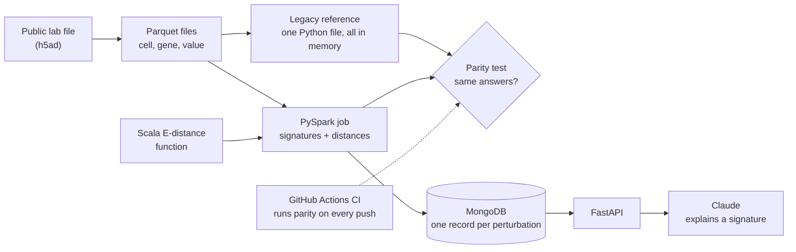

# miniXell

My proof of concept for the intended new architecture of
[protoXell](https://dataxight.com/products/protoxell), DataXight's platform for
exploring large-scale single-cell perturbation data.

The MVP shows one claim, end to end:

> A single-machine analysis, migrated to PySpark, proven to give the same
> answers, measured for where Spark and Scala pay off, and served through a
> Python API with AI explanations.

> Personal learning project. Not affiliated with or endorsed by DataXight.
> Uses only public data.

## What it does

1. Takes a public Perturb-seq dataset: cells where one gene was deliberately
   changed, with the activity of thousands of genes measured afterward.
2. Computes a **signature** for each perturbation: how much each gene moved
   compared with untouched control cells.
3. Measures how alike perturbations are (Euclidean distance and E-distance)
   and keeps each one's 20 closest matches.
4. Proves the PySpark pipeline matches a single-machine reference
   implementation (parity test, run in CI).
5. Benchmarks single machine vs Spark, and Python vs Scala for the heaviest
   calculation.
6. Serves results through FastAPI backed by MongoDB, with Claude explaining a
   signature in plain biological language.

## MVP architecture

Everything runs locally. AWS deployment follows the MVP.

## Stack

| Concern | Choice |
|---|---|
| Language | Python 3.12, Scala (one Spark function) |
| Distributed processing | PySpark (local mode in MVP) |
| Storage | Parquet files |
| Database | MongoDB (Docker locally) |
| API | FastAPI |
| AI | Claude |
| CI | GitHub Actions |
| After MVP | AWS: S3, EMR Serverless, ECS Fargate, ECR, SQS, Bedrock |

## Docs

- [docs/CONCEPTS.md](docs/CONCEPTS.md): the science and math step by step: perturbations, signatures, Euclidean distance, E-distance.
- [docs/ARCHITECTURE.md](docs/ARCHITECTURE.md): every component explained, MongoDB schema, design decisions, post-MVP architecture.
- [docs/PLAN.md](docs/PLAN.md): build plan, phase by phase, with what each phase teaches.
- [docs/COMPANY_RESEARCH.md](docs/COMPANY_RESEARCH.md): DataXight, protoXell, their engineering and problems, with sources.

## Status

Phase 0: not started.
