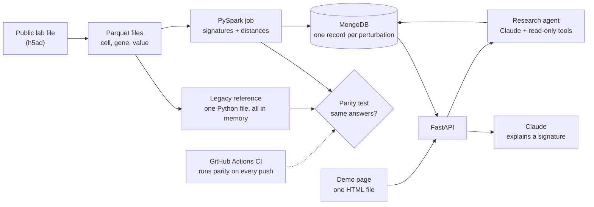

# miniXell

My proof of concept for the intended new architecture of
[protoXell](https://dataxight.com/products/protoxell), DataXight's platform for
exploring large-scale single-cell perturbation data.

The MVP shows one claim, end to end:

> A single-machine analysis, migrated to PySpark, proven to give the same
> answers, and served through a Python API with AI explanations and a research
> agent.

> Personal learning project. Not affiliated with or endorsed by DataXight.
> Uses only public data.

## What it does

1. Takes a public Perturb-seq dataset: cells where one gene was deliberately
   changed, with the activity of thousands of genes measured afterward.
2. Computes a **signature** for each perturbation: how much each gene moved
   compared with untouched control cells.
3. Measures how alike perturbations are (Euclidean distance and E-distance)
   and keeps each one's 20 closest matches.
4. Proves the PySpark pipeline matches a single-machine reference
   implementation (parity test, run in CI).
5. Computes the heaviest calculation, E-distance, in Spark two ways: plain
   Python row by row, and pandas in batches.
6. Serves results through FastAPI backed by MongoDB, with Claude explaining a
   signature in plain biological language.
7. Answers open questions with a research agent: Claude picks what to look up
   through read-only tools, code checks every name in the answer, and each
   answer comes with its lookup trail.
8. Shows it all on a one-page demo site: search a perturbation, see its top
   genes and closest matches, ask for an explanation or ask a question.

## MVP architecture

Everything runs locally. AWS deployment follows the MVP.

## Stack

| Concern | Choice |
|---|---|
| Language | Python 3.12 |
| Distributed processing | PySpark (local mode in MVP) |
| Storage | Parquet files |
| Database | MongoDB (Docker locally) |
| API | FastAPI |
| AI | Claude |
| CI | GitHub Actions |
| After MVP | AWS: S3, EMR Serverless, ECS Fargate, ECR, SQS, Bedrock |

## Docs

- [docs/CONCEPTS.md](docs/CONCEPTS.md): the science and math step by step: perturbations, signatures, Euclidean distance, E-distance.
- [docs/ARCHITECTURE.md](docs/ARCHITECTURE.md): every component explained, MongoDB schema, design decisions, post-MVP architecture.
- [docs/PLAN.md](docs/PLAN.md): build plan, phase by phase, with what each phase teaches.
- [docs/PROGRESS.md](docs/PROGRESS.md): where the build stands, step by step, and what's next.
- [docs/COMPANY_RESEARCH.md](docs/COMPANY_RESEARCH.md): DataXight, protoXell, their engineering and problems, with sources.

## Status

Phase 5 (MongoDB + FastAPI + CI) next. Details:
[docs/PROGRESS.md](docs/PROGRESS.md).
