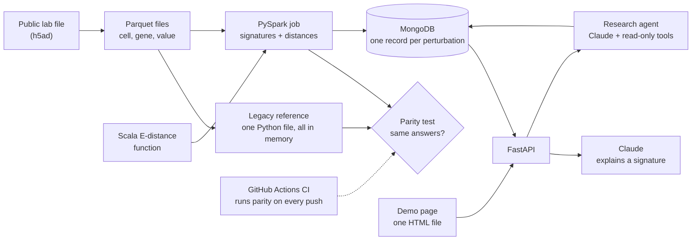
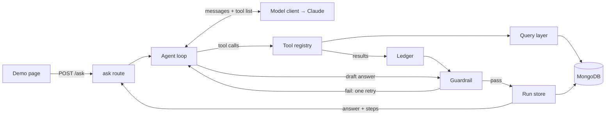
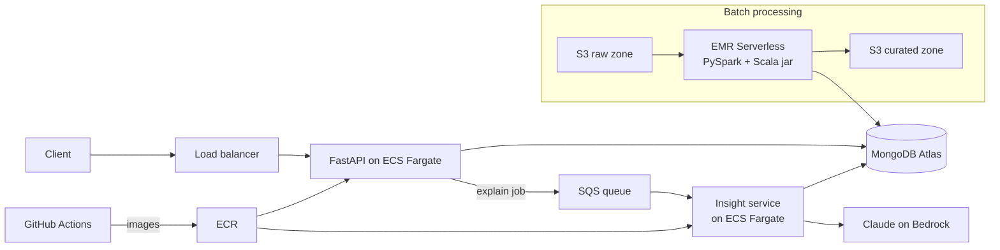

# miniXell Architecture

The MVP is a laptop-scale migration demo:

- a **legacy reference**: single-machine Python, all data in memory;
- the **new pipeline**: PySpark, work split across workers;
- a **parity test** proving both give the same answers;
- **benchmarks** showing where Spark and Scala pay off;
- an **API** serving results, with AI explanations;
- a **research agent** answering open questions from those results.

## The domain

Perturbations, activity values, signatures, Euclidean distance, and
E-distance are explained step by step in [CONCEPTS.md](CONCEPTS.md).

## MVP architecture



Flow: download lab file → convert to Parquet → PySpark computes signatures and
distances → top 20 matches per perturbation → MongoDB → FastAPI serves them →
Claude explains a signature on request; the research agent answers open
questions by looking results up. The legacy reference runs the same math on
one machine; the parity test compares the two.

## Components

### Data formats

**h5ad.** The file format scientists use for single-cell data: a cells × genes
table plus labels. Mostly zeros, so it stores only non-zero values. Spark
can't read it, so it's converted once.

**Parquet.** A file format that stores a table column by column. Reading 2 of
50 columns reads only those 2; similar values compress well; a dataset split
into many files can be read by many workers at once. .NET analogy: a SQL
Server columnstore index, saved as a file.

MVP Parquet layout:

| File | Columns | Notes |
|---|---|---|
| `cells.parquet` | cell_id, perturbation, is_control | one row per cell |
| `expression.parquet` | cell_id, gene, value | non-zero values only, 2,000 most variable genes |
| `cell_pcs.parquet` | cell_id, pc_1 … pc_50 | each cell compressed to 50 summary numbers; input for E-distance |

**Principal components (PCs).** A standard way to compress each cell's 2,000
gene values into 50 summary numbers that keep most of the differences between
cells. E-distance compares individual cells, so it runs on these 50 numbers
instead of 2,000 to stay affordable.

### Legacy reference

One Python file using pandas, Python's spreadsheet-like table library. Loads
everything into memory, then computes the same signatures and distances as the
Spark job.

- Role 1: **answer key.** Short and readable, so easy to trust.
- Role 2: **the "before"** in the migration story. It's what DataXight's
  "single-node analytical applications" look like.

### Spark and PySpark

**Spark** is the engine that splits one data job across many machines. It's
written in Scala and runs on the Java runtime. **PySpark** is the Python
library for driving that engine. .NET analogy: SQL Server is the engine; ADO.NET
is one way to send it work.

How a job runs:

- **Driver**: plans the job and hands out work.
- **Workers**: do the work. In the MVP they're CPU cores on the laptop
  (`local[*]`); on AWS they're separate machines.
- **Tasks**: the job is cut into many small pieces; workers grab the next one
  when free, so fast workers do more and a failed one is rerun elsewhere.
- **Shuffle**: regrouping data between workers so, for example, all of one
  perturbation's subtotals land on one worker. The expensive part.
- **Broadcast**: copying a small table (control averages) to every worker
  instead of moving the big table.
- **Spill**: a worker short on memory parks overflow on disk and keeps going.

Averages combine as (sum, count) pairs, never as averages of averages: workers
see different numbers of cells, so averaging their averages gives a wrong
answer.

Role in the system: the **batch layer**. It runs occasionally (minutes),
writes results, and exits. It is not the backend; FastAPI is.

### E-distance, three ways

E-distance between perturbations A and B compares individual cells: average
distance between an A cell and a B cell, minus the average spread inside A and
inside B. Rewards tight, consistent responses; penalizes scattered ones. It
runs on a fixed sample of up to 100 cells per perturbation, using their 50
principal components. Step-by-step walkthrough: [CONCEPTS.md](CONCEPTS.md)
sections 6–7.

| Implementation | How it works | Expected speed |
|---|---|---|
| Plain Python function (`udf`) | Spark ships data to Python one row at a time | Slowest |
| Grouped pandas (`applyInPandas`) | Spark ships each group's cells to Python in bulk; numpy does the math | Fast |
| Scala function | Runs inside Spark's Java runtime; no copying to Python | Fast |

Spark does the logistics in all three: reading, splitting, grouping, pairing,
collecting, writing. The function only computes one pair's number.

### Scala

A language that runs on the Java runtime; Spark's native language. .NET
analogy: Scala is to Java what F# is to C#. Built with sbt and packaged as a
jar that PySpark loads. Used here for one speed-critical function, the
typical reason teams reach for it in Spark.

### Parity test

Runs the legacy reference and the Spark job on the same input and requires:

- every signature value equal within a small tolerance;
- identical top-10 gene rankings per perturbation;
- identical nearest-neighbor rankings;
- same counts: perturbations, cells, no missing or duplicate rows.

The tolerance exists because Spark adds numbers in a different order across
workers, which changes the last digits. Cell sampling for E-distance uses one
deterministic rule shared by both sides; otherwise parity can't hold.

### Benchmarks

- **Scale**: legacy vs Spark on 10%, 25%, 50%, 100% of a dataset. Records
  wall time and peak memory; reports whichever limit appears first. On small
  data the single machine may win, because Spark has fixed coordination
  overhead.
- **Three-way**: the three E-distance implementations on the same pairs,
  parity-checked.

### MongoDB

A document database: stores JSON-like records instead of fixed-table rows.

#### Collection `perturbations`

One document per perturbation. Everything about it is embedded, so one read
answers any API request without joins. Closest matches are precomputed and
stored in order, so the API never sorts.

```json
{
  "_id": "ObjectId(…)",
  "dataset": "NormanWeissman2019",
  "name": "KLF1",
  "target_genes": ["KLF1"],
  "cell_count": 1959,
  "sampled_cell_count": 100,
  "top_genes": [
    { "gene": "KLF1", "change": 3.10 },
    { "gene": "HBG1", "change": 1.82 },
    { "gene": "MYC",  "change": -0.74 }
  ],
  "similar": {
    "euclidean": [
      { "name": "CEBPE", "distance": 0.17 },
      { "name": "KLF1_CEBPA", "distance": 0.22 }
    ],
    "edistance": [
      { "name": "CEBPE", "distance": 2.41 },
      { "name": "KLF1_CEBPA", "distance": 3.05 }
    ]
  }
}
```

Names and KLF1's cell count are real (Norman dataset); genes, changes, and
distances are illustrative.

| Field | Type | Meaning |
|---|---|---|
| `_id` | ObjectId | MongoDB's automatic record ID |
| `dataset` | string | Source dataset; lets several datasets share the collection |
| `name` | string | Perturbation label as published in the dataset (`obs["perturbation"]`); two-gene combinations join genes with `_`, e.g. `KLF1_BAK1`. Norman has no pair under two labels |
| `target_genes` | array of string | Gene or genes deliberately changed: `name.split("_")` (1 or 2) |
| `cell_count` | int | Cells that received this perturbation |
| `sampled_cell_count` | int | Cells used for E-distance (≤ 100) |
| `top_genes` | array of {gene: string, change: double} | 50 biggest moves vs control, largest absolute change first; positive = more active |
| `similar.euclidean` | array of {name: string, distance: double} | 20 closest perturbations by Euclidean distance, closest first |
| `similar.edistance` | array of {name: string, distance: double} | 20 closest by E-distance, closest first |

Rules:

- Controls are the baseline, not a perturbation; no document.
- A perturbation never appears in its own `similar` lists.
- The target gene stays in `top_genes` when it ranks there (77 of 102
  checkable targets in Norman); genes it switches on can move more than it does.
- Full 2,000-gene signatures and all pairwise distances stay in Parquet;
  MongoDB holds only what the API serves.
- Document size stays a few KB, far below MongoDB's 16 MB limit.

| Index | Serves |
|---|---|
| `{dataset: 1, name: 1}`, unique | `GET /perturbations/{name}`, `/similar`; blocks duplicates |
| `{"top_genes.gene": 1}` | `GET /perturbations?gene=X` (index on array elements) |

#### Collection `genes` (phase 6)

Public gene descriptions used to ground Claude's explanations.

```json
{
  "_id": "ObjectId(…)",
  "symbol": "HBG1",
  "full_name": "hemoglobin subunit gamma 1",
  "summary": "One-paragraph description from NCBI Gene…",
  "source": "mygene.info",
  "fetched_at": "2026-10-20T00:00:00Z"
}
```

| Index | Serves |
|---|---|
| `{symbol: 1}`, unique | Look up descriptions for a signature's genes |

#### Collection `agent_runs` (phase 7)

One record per research-agent question, so any answer can be replayed and
audited.

| Field | Meaning |
|---|---|
| `question` | User's question |
| `model`, `prompt_version` | Claude model ID and system-prompt version used |
| `steps` | Each tool call: name, inputs, output, milliseconds |
| `answer` | Final answer text (or "couldn't answer") |
| `guardrail` | Pass, or the violations found |
| `tokens`, `duration_ms`, `created_at` | Cost and timing |

### FastAPI

A Python framework for HTTP APIs. .NET analogy: ASP.NET Core minimal APIs.
Async request handling, request/response validation from type hints, and an
auto-generated docs page at `/docs`.

| Endpoint | Returns |
|---|---|
| `GET /health` | service status |
| `GET /perturbations?gene=&limit=` | perturbations, optionally those where a gene is in the top genes |
| `GET /perturbations/{name}` | one perturbation's document |
| `GET /perturbations/{name}/similar?metric=` | its 20 closest matches |
| `POST /perturbations/{name}/explain` | Claude's explanation of the signature |
| `POST /ask` | research agent's answer to an open question, plus its steps (phase 7) |

### Demo page (phase 6)

One static HTML file (`api/static/index.html`) served by FastAPI; plain
JavaScript, no build step, no second app. Search box → a perturbation's top
genes and similar list → Explain button shows Claude's text, or the
guardrail's rejection. Phase 7 adds an Ask box showing the agent's answer and
its step list. FastAPI's `/docs` page stays as the developer view.

### Claude explanation

The explain endpoint fetches the signature and public one-paragraph gene
descriptions, sends both to Claude, and returns the explanation.

- **Grounding**: the prompt contains only the signature and the fetched
  descriptions; Claude explains them, never computes results.
- **Guardrail**: an explanation naming a gene absent from the signature or the
  descriptions is rejected.

Mirrors protoXell's rule: "The LLM does not generate or alter results; it only
interprets deterministic outputs."

### Research assistant agent (phase 7)

Answers open questions about the results, e.g. "Which perturbations act like
KLF1, and what do they share?" Claude chooses what to look up; code fetches
the data, does all math, and checks every name in the answer. Each answer
returns with the lookups that produced it.



Flow: question → Claude gets the tool list → asks for a tool → code runs it and
returns the result → repeat until a final answer → guardrail → run saved →
answer + steps returned.

| Piece | File | Job |
|---|---|---|
| Query layer | `api/repository.py` | MongoDB queries shared by endpoints and tools; a tool can't disagree with an endpoint |
| Tools | `api/agent/tools.py` | Five tools: name, description, typed inputs, function; typed inputs generate what Claude reads and validate its requests |
| Model client | `api/agent/llm.py` | Interface with a real Claude client and a scripted fake for tests; Bedrock swaps in here |
| Loop | `api/agent/loop.py` | Sends messages, runs requested tools (several at once with `asyncio.gather`), enforces limits |
| Ledger + guardrail | `api/agent/guardrail.py` | Records tool outputs; checks the answer; shared with the explain endpoint |
| Run store | `api/agent/runs.py` | Saves each run to `agent_runs` |
| Route | `api/routes/ask.py` | `POST /ask` → `{answer, steps[]}` |

| Tool (all read-only) | Returns |
|---|---|
| `get_perturbation(name)` | Target genes, cell count, top genes |
| `get_similar(name, metric)` | 20 closest perturbations |
| `find_by_gene(gene)` | Perturbations with that gene in their top 50 |
| `get_gene_descriptions(symbols)` | Public descriptions from `genes` |
| `compare_signatures(a, b)` | Shared top genes and whether each moved the same or opposite way, computed in Python |

Rules:

- **One agent, hand-written loop.** Anthropic's Python library with tool use;
  no agent framework, no multiple agents.
- **Small computed facts.** Tools return compact results (top 10 genes unless
  asked for more); the model never calculates.
- **No memory between questions.** Each question starts fresh.
- **Limits in code.** 8 tool calls, 30 s, token cap; hitting one returns
  "couldn't answer."
- **System prompt.** Use only tool data; say "not in the data" when missing;
  never calculate; name sources.
- **Guardrail.** Vocabulary = every gene symbol and perturbation name in the
  dataset. A vocabulary name in the answer but not in the ledger, or a quoted
  number not matching a ledger value after rounding, is a violation → one
  correction retry → reject.
- **Tests.** Tools against the test database; loop against the scripted fake;
  guardrail with a planted made-up gene and a wrong number.

### CI

GitHub Actions on every push: lint, unit tests, API tests, and the parity test
on a small fixture dataset kept in the repo. A change that breaks parity can't
merge.

## Design decisions

**Legacy reference in Python, not Node.js.** DataXight's Node.js code is the
service layer; the Spark migration targets single-machine analysis tools.
Python vs PySpark changes only one thing, one machine vs many. Node vs PySpark
would change language and distribution at once, so results couldn't be
attributed.

**Euclidean distance and E-distance.** DataXight's own benchmark winners for
speed and signal clarity.

**No microservices in the MVP.** Each split turns a function call into a
network call: timeouts, partial failures, more pipelines. The MVP has one
service plus a batch job, which already deploy separately for a real reason:
the batch job runs rarely and needs many workers; the API is always on and
cheap. A second service is added after the MVP, for a concrete reason.

**Local first.** Every concept runs on the laptop before it costs money in
AWS. Spark code is the same in local mode and on a cluster.

## After the MVP



| Component | What it is | .NET / Azure analogy |
|---|---|---|
| S3 | AWS file storage; buckets hold objects (files) | Azure Blob Storage |
| Raw / curated zones | S3 folders by stage: as received vs processed | — |
| EMR Serverless | Runs a Spark job on machines AWS starts and stops for you; pay per second | Azure Functions, for heavy batch jobs |
| ECR | Private storage for Docker images | Private NuGet feed, for images |
| ECS on Fargate | Runs containers, restarts crashed ones, rolls out new versions; no servers to manage | Azure Container Apps |
| EC2 (not used) | Rented virtual machine you manage yourself | Azure VM |
| Load balancer | Single front door spreading requests across container copies | Azure Application Gateway |
| SQS | Managed message queue; messages wait if the receiver is down | Azure Service Bus queue |
| Bedrock | AWS-hosted access to LLMs including Claude | Azure OpenAI Service |
| IAM + OIDC | AWS permissions; GitHub gets short-lived AWS credentials, no stored keys | Managed identities |

**The one microservice split.** The explain feature and the research agent
move out of the API into an Insight service behind SQS (same agent loop; `/ask`
returns a job ID). LLM calls are slow, costly, and sometimes fail;
behind a queue they can't slow down or break the API, and the service scales
on queue length rather than web traffic. Extracting a working feature from a
running system is the strangler-fig pattern, the same move as a Node.js →
Python migration.
